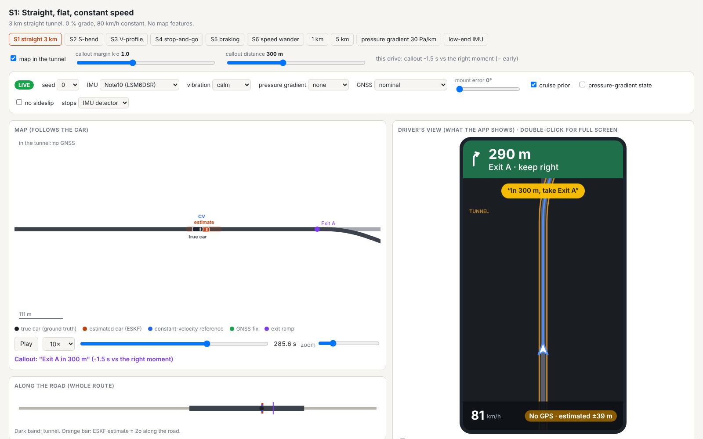

# Through the Tunnel

Phone-based position estimation through a GNSS outage in a road tunnel (single lane, 500 m to
5 km), for a navigation app that must keep showing the car, call out an exit inside the tunnel at
the right moment, and recover cleanly when the car comes out. Only the phone's own sensors
(accelerometer, gyroscope, barometer, GNSS) and the navigation map are used.

**Write-up:** [`SUMMARY.md`](SUMMARY.md) (about two pages) and the full [`REPORT.md`](REPORT.md):
approach, what is simulated, assumptions, results, where it breaks and why, AI usage.

## Quick start

```bash
pip install -r requirements.txt      # Python >= 3.10
python tools/serve.py                # live simulator: open http://localhost:8000
python tools/simulate.py S1          # or a single self-contained page: sim_S1_seed0.html
```

**One page, two modes.** [`docs/sim/index.html`](docs/sim/index.html) holds every scenario as a
tab (pre-run drives, seed 0), a map-layer on/off switch and sliders for the callout margin k·σ and
the callout distance, all evaluated in the browser. Opened as a file or from GitHub Pages
(`https://alpermutlu2.github.io/Tunnel-navigation/sim/`) it needs no Python. Served by
`tools/serve.py`, the same page finds the server and shows a **LIVE** bar: seed, IMU profile,
vibration, tunnel pressure gradient, the filter's mount error, GNSS degradations, the cruise prior,
the pressure-gradient state, sideslip and the stop detector. Each change re-runs truth → sensors →
ESKF in Python for one seed (~7 s, standard library server, results cached) and loads the result in
place. A **custom tunnel** row in the same bar builds a new scenario without code: tunnel length
(0.5–5 km), grade inside the tunnel, speed, and one stop (duration and position); it appears as a
"Custom" tab (`tunnelsim/scenario.py: get_scenario("custom:L=2000,g=3,v=70,stop=30,at=0.3")`, also
accepted by `tools/simulate.py`). `http://localhost:8000/controls` has the remaining switches (cruise model, NHC turn gate,
re-acquisition). Rebuild the page with `python tools/build_site.py`.

**In-browser live mode (experimental).** `docs/sim/browser.html`
(`https://alpermutlu2.github.io/Tunnel-navigation/sim/browser.html`) is the same page with the LIVE
controls answered in the browser: the same Python package runs in a Web Worker under Pyodide
(CPython in WebAssembly), so no server is needed. The first load downloads ~30 MB and each run is
slower than with `serve.py`; if Pyodide cannot load, the page falls back to the pre-run drives.
`index.html` is unchanged.

**Model sliders** (live mode; on GitHub Pages they show disabled, with the command to start the
server): speed × factor for the whole scenario, a speed change inside the tunnel (±30 km/h at a
chosen fraction of its length, held 20 s, then back), GNSS exit multipath, tunnel
pressure gradient, vibration level, accelerometer bias instability × factor, the filter's map
error (lateral offset, length error), the filter's driver model (σ_d, τ_d) and the NHC turn gate.
Sensor and world values set this way are tagged [ASSUMED, "live slider"]; changed sliders turn
orange, and "reset sliders" returns to the nominal values. Playback speeds: 1×, 2×, 5×, 10×, 30×, 60×.

**Results table.** The last tab puts every scenario side by side, one drive each, under the
current settings: along-track error and 2σ at the exit diverge, the largest error in the tunnel,
along- and cross-track error and (e/σ)² at the portal, callout timing (with the k·σ and distance
sliders), the constant-velocity reference and the 1D EKF baseline. Without the server it uses the pre-run drives; in
live mode "Re-run every tab with the live settings" fills it from new runs (~70 s for all tabs).

**Three filters and the app.** The 4-state 1D EKF (teal), the 10-state map-constrained filter
(amber) and the 16-state ESKF (orange) run on the same sensor data. The app (pink) shows the one
the supervisor selects (ESKF on a Note10-class IMU, 10-state on a low-end one), with its σ raised
when it disagrees with both others, and a rate-limited follower after the exit. "Show" boxes
switch each trace on and off; the banner marks ZUPTs, the ESKF's map re-associations and filter
disagreement (REPORT §4.9, §4.11, §4.12).

**Driver's view.** Next to the map, a phone-shaped panel shows what the navigation app would show
from the estimate alone: heading-up, the car snapped to the road, the maneuver banner with the
distance to the exit, the spoken callout at the moment the k·σ rule fires, speed, and "No GPS ·
estimated ±2σ" in the tunnel. "Show the true car" adds the ground truth as a ghost.

**Full screen and playback.** Double-click any panel (map, road strip, sensors, driver's view, Now,
error and speed plots) for full screen; a playback bar (play/pause, ±1 s, ±10 s, scrub, speed)
comes with it. Space plays or pauses and ← → step 1 s (Shift: 10 s) everywhere. All panels share
one time cursor, and changing a parameter keeps the time position.



The map shows the true car (ground truth) and the estimated car side by side, drawn to scale and
rotated to their headings.


Recording: [`docs/media/sim_S5_seed0.mp4`](docs/media/sim_S5_seed0.mp4) (S5, seed 0, map and
driver's view, from 15 s before the portal to 45 s after the exit, 10× real time; frames stepped with
`tools/record_frames.js` and Playwright, encoded with ffmpeg).

The simulator page is self-contained (no server, no internet). It shows the road from above with
the tunnel, the exit branch and the main tunnel continuation, the true car and the estimated car with
its along-track 2σ bar, a constant-velocity reference, GNSS fixes, the error and speed plots, the
exit callout (with its timing error against the right moment), and the phone sensor data the app
records (accelerometer, gyroscope, barometer, GNSS speed). Play/pause, speed and zoom are on the
page.

```bash
python tools/simulate.py --list                                     # scenarios and named overrides
python tools/simulate.py S4 --seed 7                                # another noise realisation
python tools/simulate.py S5 --override gnss_lagging --override vib_noisy   # parameter changes
python tools/simulate.py S4 --zupt oracle                           # stops given by the truth
python tools/simulate.py S1 --eskf cruise=False --eskf nhc_turn_gate=0   # any EskfConfig field
python tools/simulate.py S1 --mount-err 0,3,3                       # filter's mount wrong [deg]
python tools/simulate.py S2 --no-sideslip                           # car without sideslip
python tools/simulate.py S1-5km                                     # tunnel length 0.5/1/5 km variants
python tools/simulate.py S3 --override baro_tunnel_30pa             # tunnel pressure gradient
```

New scenarios are added in `tunnelsim/scenario.py` (`build_scenarios`: road geometry, grade
profile, speed events); sensor parameters and named overrides in `tunnelsim/profiles.py`; filter
settings in `EskfConfig` (`tunnelsim/eskf.py`).

## Scenarios

| Key | Tunnel | Driving |
|---|---|---|
| S1 | 3 km straight, flat | 80 km/h constant (no map features: hardest) |
| S2 | 2.5 km with an S-bend (R = 400 m) | 80 km/h constant |
| S3 | 3.5 km V-profile (−5 % / flat / +5 %) | 70 km/h constant |
| S4 | 3 km straight | stop-and-go: two full stops and a crawl |
| S5 | 3 km straight | slow drift 90 → 82 km/h, braking to 50 km/h before the exit |
| S6s / S6 / S6L | as S1 | speed wander ±1 / ±2 / ±4 km/h with 40 s ramps |
| S1-0.5km / S1-1km / S1-5km | as S1, other lengths | 80 km/h constant |

In every scenario the route leaves the main tunnel through an exit branch inside the tunnel
(20° right over 150 m), announced 300 m before the diverge, and comes out at the branch portal.
Each scenario starts with 200 s of open-sky driving (GNSS calibration, including a few speed
changes).

## Evaluation

```bash
python tools/evaluate.py                 # Monte Carlo, 50 seeds per scenario (~1 h on 2 cores)
python tools/evaluate.py --seeds 20 S1 S4 --negative   # subset + car-goes-straight control
python tools/eval_sets.py default       # ESKF on six sets of 50 seeds (0-299); --validation: 300-399 once
python tools/ekf10_sets.py               # 10-state filter variants on 0-299 (v0.5.12); --validation: 300-399
python tools/compare_filters.py         # 4-, 10- and 16-state filters, 50 seeds, Note10 + low-end
python tools/supervisor_eval.py sets:0-100   # supervisor (class rule, monitor) on seed ranges
python tools/failure_cases.py           # pressure gradient and 2x map error under the gate / re-association
python -m pytest -q tests                # ~150 tests (+2 slow: --runslow)
python tools/snapshot.py                 # reports/<version>/metrics.json (tests, truth, sensors, INS, budget, ESKF)
python tools/snapshot.py --diff 0.4.0 0.5.0
```

Other tools: `tools/budget.py` (INS error budget, v0.4), `tools/allan_scatter.py`,
`tools/baro_model_check.py`, `tools/plot_nhc_trace.py`, `tools/plot_truth.py`.

## Repository map

- `tunnelsim/`: truth generator (`truth.py`, `scenario.py`), sensor models (`sensors.py`,
  `profiles.py`), strapdown INS (`ins.py`), ESKF (`eskf.py`), 1D map-constrained EKF baseline
  (`reference1d.py`), 10-state map-constrained filter (`ekf10.py`), supervisor (`supervisor.py`),
  branch check (`branch.py`),
  experiments and metrics (`experiments.py`, `budget.py`). The estimator side never imports the
  truth objects (`docs/contracts.md`).
- `DESIGN.md`: assumptions, sensor models, error budget, estimator roadmap, decision log.
- `docs/decisions/`, `docs/reviews/`: decision records and the reviews behind them.
- `CHANGELOG.md`: what changed per version and how the numbers moved.
- `reports/<version>/`: metrics snapshots and Monte Carlo results.

Every parameter is tagged [MEAS] (measured, cited), [SPEC] (datasheet) or [ASSUMED]; sensitivity
cases are named overrides, never defaults.
