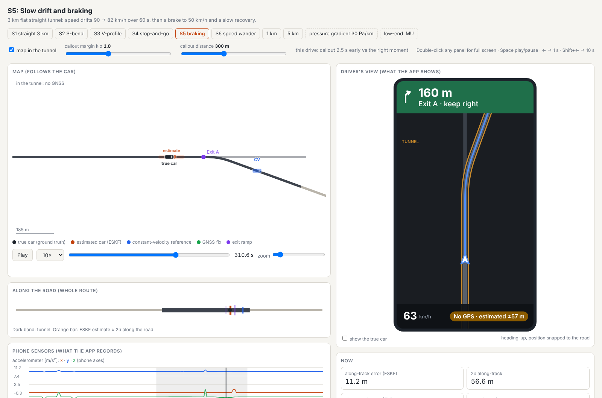

# Through the Tunnel

Phone-based position estimation through a GNSS outage in a road tunnel (single lane, 500 m to
5 km), for a navigation app that must keep showing the car, call out an exit inside the tunnel at
the right moment, and recover cleanly when the car comes out. Only the phone's own sensors
(accelerometer, gyroscope, barometer, GNSS) and the navigation map are used.

**Write-up:** [`REPORT.md`](REPORT.md): approach, results, where it breaks and why, AI usage.

## Quick start

```bash
pip install -r requirements.txt      # Python >= 3.10
python tools/serve.py                # interactive: open http://localhost:8000
python tools/simulate.py S1          # or a single self-contained page: sim_S1_seed0.html
```

**Without Python:** `docs/sim/` holds pre-run pages for every scenario and the failure cases
(`docs/sim/index.html`; with GitHub Pages serving `/docs` they open at
`https://alpermutlu2.github.io/Tunnel-navigation/sim/`). Rebuild them with `python tools/build_site.py`.

`tools/serve.py` opens the simulator with controls on the left (scenario, seed, IMU profile,
vibration, tunnel pressure gradient, the filter's mount error, GNSS degradations, filter switches
such as the map in the tunnel, the cruise prior, the NHC turn gate and the pressure-gradient
state). Every change re-runs
truth → sensors → ESKF for one seed (~7–10 s; standard library only, results cached). The map
shows the true car (ground truth) and the estimated car side by side, drawn to scale and rotated
to their headings.



Recording: [`docs/media/sim_S5_seed0.mp4`](docs/media/sim_S5_seed0.mp4) (S5, seed 0, from 15 s
before the portal to 45 s after the exit, 10× real time; frames stepped with
`tools/record_frames.js` and Playwright, encoded with ffmpeg).

The simulator page is self-contained (no server, no internet). It shows the road from above with
the tunnel, the exit branch and the main tunnel continuation, the true car and the estimated car with
its along-track 2σ bar, a constant-velocity reference, GNSS fixes, the error and speed plots, the
exit callout (with its timing error against the right moment), and the phone sensor data the app
records (accelerometer, gyroscope, barometer, GNSS speed). Play/pause, speed and zoom are on the
page.

```bash
python tools/simulate.py --list                                     # scenarios and named overrides
python tools/simulate.py S4 --seed 7                                # another noise realisation
python tools/simulate.py S5 --override gnss_lagging --override vib_noisy   # parameter changes
python tools/simulate.py S4 --zupt oracle                           # stops given by the truth
python tools/simulate.py S1 --eskf cruise=False --eskf nhc_turn_gate=0   # any EskfConfig field
python tools/simulate.py S1 --mount-err 0,3,3                       # filter's mount wrong [deg]
python tools/simulate.py S2 --no-sideslip                           # car without sideslip
python tools/simulate.py S1-5km                                     # tunnel length 0.5/1/5 km variants
python tools/simulate.py S3 --override baro_tunnel_30pa             # tunnel pressure gradient
```

New scenarios are added in `tunnelsim/scenario.py` (`build_scenarios`: road geometry, grade
profile, speed events); sensor parameters and named overrides in `tunnelsim/profiles.py`; filter
settings in `EskfConfig` (`tunnelsim/eskf.py`).

## Scenarios

| Key | Tunnel | Driving |
|---|---|---|
| S1 | 3 km straight, flat | 80 km/h constant (no map features: hardest) |
| S2 | 2.5 km with an S-bend (R = 400 m) | 80 km/h constant |
| S3 | 3.5 km V-profile (−5 % / flat / +5 %) | 70 km/h constant |
| S4 | 3 km straight | stop-and-go: two full stops and a crawl |
| S5 | 3 km straight | slow drift 90 → 82 km/h, braking to 50 km/h before the exit |
| S6s / S6 / S6L | as S1 | speed wander ±1 / ±2 / ±4 km/h with 40 s ramps |
| S1-0.5km / S1-1km / S1-5km | as S1, other lengths | 80 km/h constant |

In every scenario the route leaves the main tunnel through an exit branch inside the tunnel
(20° right over 150 m), announced 300 m before the diverge, and comes out at the branch portal.
Each scenario starts with 200 s of open-sky driving (GNSS calibration, including a few speed
changes).

## Evaluation

```bash
python tools/evaluate.py                 # Monte Carlo, 50 seeds per scenario (~1 h on 2 cores)
python tools/evaluate.py --seeds 20 S1 S4 --negative   # subset + car-goes-straight control
python -m pytest -q tests                # ~150 tests (+2 slow: --runslow)
python tools/snapshot.py                 # reports/<version>/metrics.json (tests, truth, sensors, INS, budget, ESKF)
python tools/snapshot.py --diff 0.4.0 0.5.0
```

Other tools: `tools/budget.py` (INS error budget, v0.4), `tools/allan_scatter.py`,
`tools/baro_model_check.py`, `tools/plot_nhc_trace.py`, `tools/plot_truth.py`.

## Repository map

- `tunnelsim/`: truth generator (`truth.py`, `scenario.py`), sensor models (`sensors.py`,
  `profiles.py`), strapdown INS (`ins.py`), ESKF (`eskf.py`), branch check (`branch.py`),
  experiments and metrics (`experiments.py`, `budget.py`). The estimator side never imports the
  truth objects (`docs/contracts.md`).
- `DESIGN.md`: assumptions, sensor models, error budget, estimator roadmap, decision log.
- `docs/decisions/`, `docs/reviews/`: decision records and the reviews behind them.
- `CHANGELOG.md`: what changed per version and how the numbers moved.
- `reports/<version>/`: metrics snapshots and Monte Carlo results.

Every parameter is tagged [MEAS] (measured, cited), [SPEC] (datasheet) or [ASSUMED]; sensitivity
cases are named overrides, never defaults.
